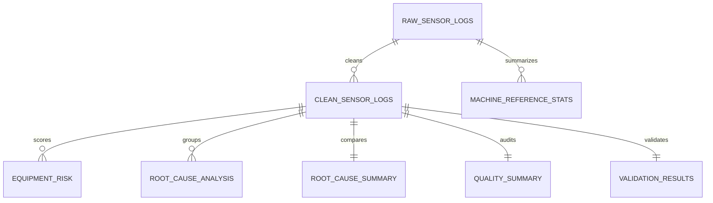

# Data model

## Entity overview

## Table roles

| Table | Type | Purpose |
|---|---|---|
| `raw_sensor_logs` | Source | Immutable landing table for simulated sensor events. |
| `machine_reference_stats` | Derived | Per-machine medians used for repair values. |
| `clean_sensor_logs` | Derived | Standardized and repaired sensor events. |
| `quality_summary` | Derived | One-row data quality audit. |
| `metric_thresholds` | Config | Business-defined healthy operating limits. |
| `equipment_risk` | Derived | 72-hour rolling risk score by machine. |
| `root_cause_analysis` | Derived | Batch and shift comparison for the target machine. |
| `root_cause_summary` | Derived | Tool-wear impact comparison. |
| `strategy_summary` | Derived | Financial benefit estimate. |
| `data_source_inventory` | Metadata | Source systems and configuration origins. |
| `data_lineage` | Metadata | Source-to-target transformation map. |
| `pipeline_run_log` | Metadata | Run status, timing, and row counts. |
| `validation_results` | Quality gate | SQL assertions that must pass before reporting. |
